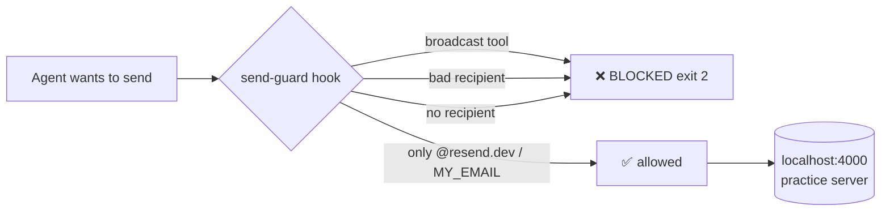

<div align="center">

# 🫖 Kettlebird Tea — Email Studio

### A safe, practice-only email-marketing studio built with Claude Code

Plan a launch, write on-brand emails, personalize them per audience, and **send only to a local
practice server** — with a hard guardrail that makes sending to a real person impossible.


</div>

> [!IMPORTANT]
> **This is a practice lab.** *Kettlebird Tea* and *The Steep Club* are made up. There is no real
> customer, no real inbox, and no real mail is ever sent. Every lead address ends in `@example.com`
> and every send goes to a local emulator at `http://localhost:4000`.

---

## ✨ What's inside

| Area | What it does |
|---|---|
| 🎙️ **Brand voice** | A single source of truth for tone (`brand/voice.md`) — warm, playful, founder *"Mina"*. |
| 🗺️ **Campaign plan** | A 10-section launch plan for *The Steep Club* subscription box (`campaigns/.../plan.md`). |
| 👥 **Fake leads** | 24 invented leads in 3 audiences (curious / regulars / gifters), all `@example.com`. |
| ✉️ **Emails** | 4 base launch emails + 12 personalized versions, each checked against the brand rules. |
| 🛡️ **Send-guard hook** | A `PreToolUse` hook that blocks any send to a non-test address and all broadcasts. |
| 🔌 **MCP practice server** | `.mcp.json` points a Resend-style MCP server at a **local** emulator — never the real API. |
| 🔍 **Review script** | A schema-validated `claude -p` reviewer that fails CI on any HIGH finding. |
| 📦 **studio-kit plugin** | The reusable, brand-agnostic version of the guardrails — drop into any client studio. |

---

## 🗂️ Repository layout

```
my-email-studio/
├── brand/voice.md                     # tone source of truth (imported into CLAUDE.md)
├── campaigns/steep-club-launch/
│   ├── plan.md                        # the launch plan
│   ├── sequence.md                    # send order, flow, A/B subject tests
│   ├── emails/                        # 4 base emails (01–04)
│   └── personalized/                  # 12 files: curious / regulars / gifters
├── leads/
│   ├── leads.csv                      # 24 fake leads (all @example.com)
│   └── CLAUDE.md                      # folder rules (privacy, fake data only)
├── .claude/
│   ├── rules/emails.md                # path-scoped rules for email files
│   ├── skills/personalize/SKILL.md    # fork skill → writes the 12 personalized emails
│   ├── hooks/send-guard.mjs           # the safety hook (block = exit 2)
│   └── settings.json                  # wires the hook on send-style tools
├── .mcp.json                          # Resend MCP → local emulator, no real key
├── scripts/
│   ├── send-launch.mjs                # sends email 01 per group to the practice server
│   ├── review.mjs                     # schema-validated email review, exits 1 on HIGH
│   └── gen-reviews.mjs                # generates 120 fake reviews
├── review/                            # schema + a deliberately-bad sample + baseline
├── studio-kit/                        # the reusable plugin (+ its own marketplace entry)
├── notes/                             # skills shortlist, handoff, scratchpad, experiments
└── CLAUDE.md                          # the studio's golden rules
```

---

## 🛡️ The safety model

Three independent layers make a mistake hard:

1. **Golden rules** (`CLAUDE.md`) — practice server only, `@resend.dev` + owner email only, no broadcasts, no secrets in git, fake data only.
2. **The send-guard hook** (`.claude/hooks/send-guard.mjs`) — runs *before* any send-style tool and **blocks** (exit code `2`) if:
   - the tool looks like a broadcast / bulk / audience send, **or**
   - any recipient isn't `*@resend.dev` or the owner's `MY_EMAIL`, **or**
   - there's no recognisable recipient at all.
3. **No real credentials** — `MY_EMAIL` lives only in gitignored `.claude/settings.local.json`; `.mcp.json` uses a dummy key and a `localhost` base URL.



---

## 🚀 Quick start

```bash
# 1) Start the local practice server (Resend emulator)
npx emulate@0.12.3 start --service resend        # serves http://localhost:4000

# 2) Set your one allowed real recipient (gitignored, never committed)
echo '{ "env": { "MY_EMAIL": "you@example.com" } }' > .claude/settings.local.json

# 3) Do a practice launch (email 01 to each group, to a @resend.dev test inbox)
node scripts/send-launch.mjs

# 4) Review an email against the brand rules (fails on any HIGH finding)
node scripts/review.mjs campaigns/steep-club-launch/emails/01-the-kettles-on.md
```

---

## 🧪 How to test this project

Everything here can be verified without sending a single real email.

### ✅ Automated / scripted checks

| What to test | Command | Expected |
|---|---|---|
| **Send-guard blocks bad recipients** | `echo '{"tool_name":"send_email","tool_input":{"to":["ava@example.com"]}}' \| node .claude/hooks/send-guard.mjs; echo $?` | exit **2** (blocked) |
| **Send-guard allows test inbox** | `echo '{"tool_name":"send_email","tool_input":{"to":["delivered@resend.dev"]}}' \| node .claude/hooks/send-guard.mjs; echo $?` | exit **0** (allowed) |
| **Broadcasts always blocked** | `echo '{"tool_name":"send_broadcast","tool_input":{"to":["delivered@resend.dev"]}}' \| node .claude/hooks/send-guard.mjs; echo $?` | exit **2** |
| **No banned words / health claims** | `grep -rinE 'detox\|cure\|boost\|immunity\|superfood\|miracle\|hurry\|guaranteed' campaigns/` | no matches |
| **All leads are fake** | `tail -n +2 leads/leads.csv \| grep -v '@example.com' \| wc -l` | **0** |
| **No secrets committed** | `git grep -nE 're_[A-Za-z0-9]{20,}'` and `git check-ignore .claude/settings.local.json` | no real key; file ignored |
| **Review script catches a bad email** | `node scripts/review.mjs review/samples/bad-email.md` | exits **1** (HIGH findings) |
| **Plugin validates** | `claude plugin validate studio-kit` | `Validation passed` |
| **Practice server round-trip** | `curl -s -XPOST localhost:4000/emails -d '{"to":["delivered@resend.dev"],...}'` then `GET /emails` | message appears |

### 🔭 Ideas worth adding next

- **A tiny test runner** (`scripts/test.sh`) that runs every row above and prints a PASS/FAIL summary — so the whole lab self-checks in one command.
- **CI on push** — the repo already has `.github/workflows/email-review.yml`; extend it to also run the send-guard cases and the banned-word scan.
- **Frontmatter linter** — assert every email has `subject` (< 45 chars), `preview` (40–90 chars), one `cta_text`, a valid `utm_` URL, and the unsubscribe footer.
- **Snapshot the practice inbox** — after `send-launch.mjs`, assert exactly N messages landed and none went to a non-test address.
- **A second fake client** — point `studio-kit` at a different brand to prove it's truly brand-agnostic.

---

## 📦 studio-kit (reusable plugin)

The guardrails, minus anything Kettlebird-specific, packaged as a Claude Code plugin.

```bash
/plugin marketplace add hafiznaveedchuhan-ctrl/my-email-studio
/plugin install studio-kit --marketplace hafiznaveedchuhan-ctrl/my-email-studio
```

Ships: the **send-guard hook**, an **email-reviewer subagent**, a **personalize skill**, and the
**review script**. See [`studio-kit/README.md`](studio-kit/README.md).

---

## 📝 Short summary

**Kettlebird Email Studio** is a hands-on lab that shows how to run a real-feeling email launch —
brand voice → plan → leads → copy → personalization → sending → review — entirely in a **safe,
fake, practice environment**. The headline idea is the **send-guard**: a pre-send hook that makes
it structurally impossible to email a real person, so you can practice the whole workflow with zero
risk. The reusable `studio-kit` plugin lets you carry the same guardrails into any other project.

<div align="center">

*Built as the FDE-102 Email Studio lab. Warmly, Mina & the Kettlebird flock 🐦*

</div>
